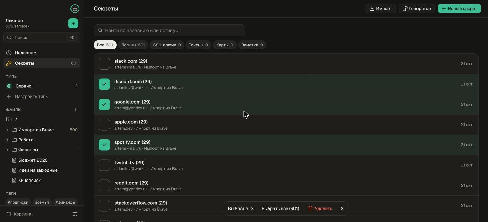
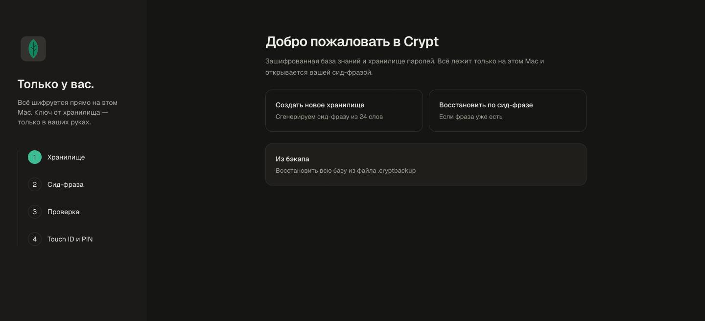
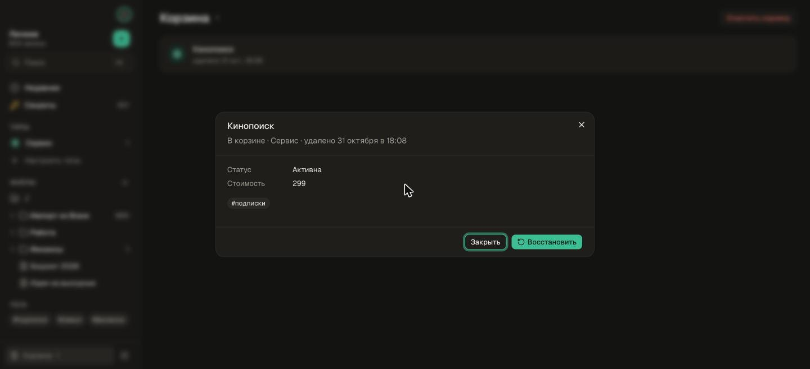

# Crypt

Зашифрованная база знаний и хранилище паролей для macOS. Всё лежит только на вашем Mac
и открывается сид-фразой из 24 слов, а в обычной работе — по Touch ID или PIN.



## Возможности

- **Заметки** с типами и полями, таблицами, папками, тегами и ссылками `[[…]]`
- **Секреты:** логины с TOTP, SSH-ключи со встроенным ssh-agent, токены, карты, защищённые заметки
- **Импорт** из Chrome/Brave/Safari/Firefox, KeePass, Obsidian и приложений 2FA
- **Бэкап** в один файл, снимки для отката и корзина

<p>
  
  
</p>

## Установка

Скачайте `.dmg` из [последнего релиза](https://github.com/ArtemDan1/Crypt/releases/latest)
и перетащите Crypt в «Программы». Сборка не подписана: при первом запуске откройте её
через правый клик → «Открыть».

## Разработка

Нужны Rust 1.94+, Node 26+, pnpm 11+ и Xcode.

```bash
cd apps/desktop
pnpm install
pnpm tauri dev    # приложение
pnpm dev          # в браузере с фейковым бэкендом
pnpm tauri build  # сборка .app
```

Тесты: `cargo test --workspace` и `cd apps/desktop && pnpm test`.

```
crates/crypt-core   ядро на Rust: шифрование, CRDT-хранилище, поиск
apps/desktop        приложение на Tauri 2 + Vue 3
```

Подробнее про секреты, ssh-agent, хранение данных и подпись — в [docs/guide.md](docs/guide.md).
